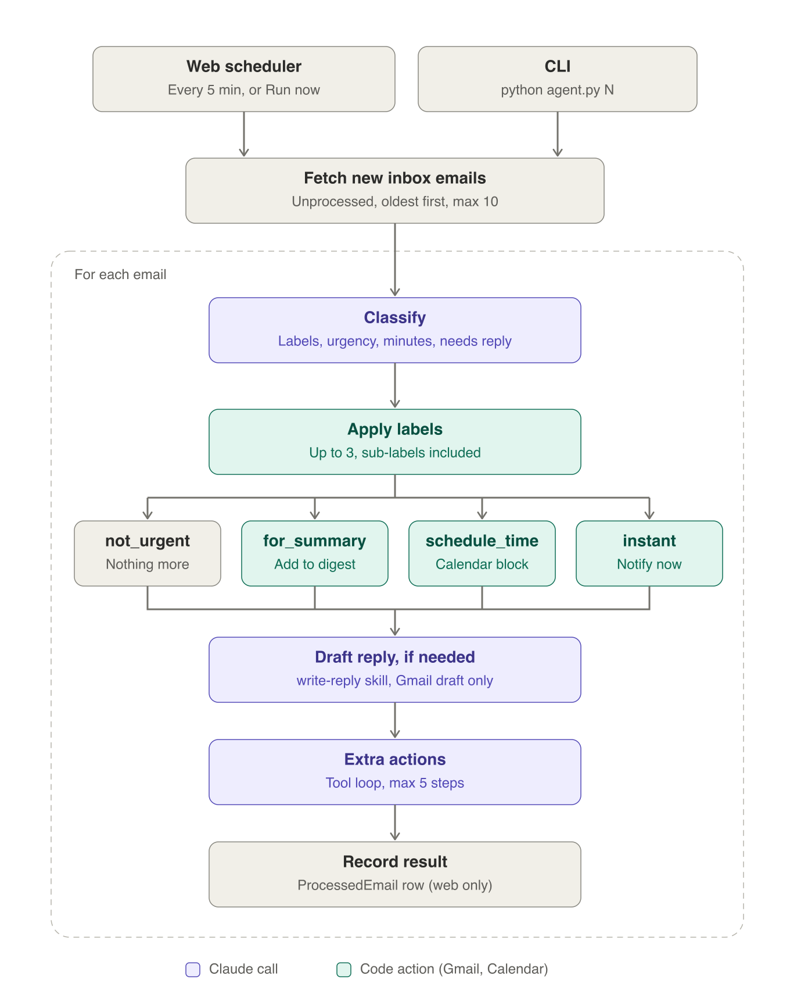

# Email agent

An email agent that works inside Gmail. For each new email it adds labels, takes the
action that matches the email's urgency, drafts a reply when someone is waiting for
one, and lets Claude take any extra steps that would help. Replies are only ever saved
as drafts, never sent.

## How it works



1. **Trigger.** The web scheduler runs every 5 minutes for each enabled user, and
   when someone clicks "Run now". The CLI processes the newest N emails of the
   `token.json` account.
2. **Classify** (Claude). Picks 0 to 3 labels from your Gmail labels, using the
   descriptions in [labels.md](labels.md). Also returns the urgency, the minutes
   needed to reply, whether a reply is needed, and a one-sentence summary.
3. **Required actions** (code). Applies the labels, then runs the action for the
   urgency: `for_summary` adds the email to the digest, `schedule_time` blocks
   calendar time, and `instant` notifies you.
4. **Draft reply** (Claude). Runs only when a reply is needed. Follows
   [skills/write-reply/SKILL.md](skills/write-reply/SKILL.md) and saves a Gmail draft.
5. **Extra actions** (Claude). A tool loop of at most 5 steps that can call the
   tools in [actions.py](actions.py) for anything beyond the required minimum.

See [agent_outline.md](agent_outline.md) for the tools, limits and guardrails.

## Setup

Requires [uv](https://docs.astral.sh/uv/).

```bash
make setup
```

This installs the dependencies, creates `.env` from `.env.example` and sets up the
database. Then add your `ANTHROPIC_API_KEY` to `.env`. For the web app, also add
the Google OAuth client values.

## Usage

```bash
make dev        # web app on http://localhost:8000, plus the scheduler
make agent N=3  # CLI: process the newest 3 emails (needs credentials.json)
make test       # run the tests
```

Run `make help` to see every command.
